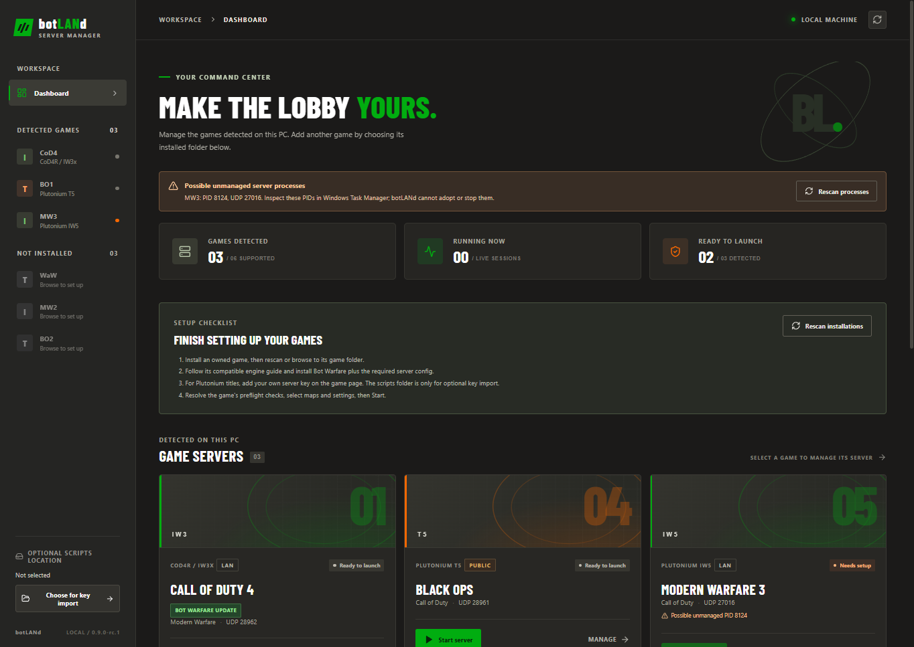
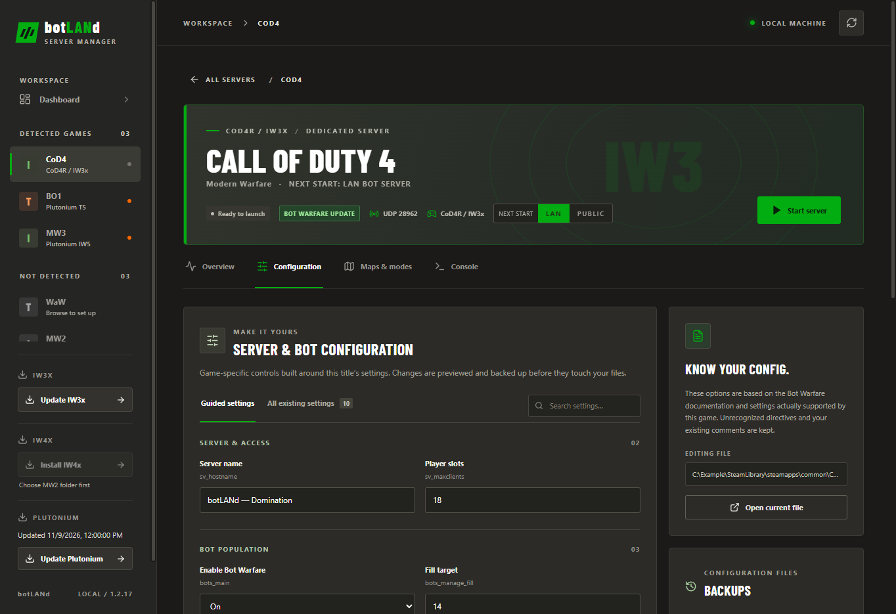

# botLANd Server Manager

Windows desktop app for setting up, configuring and launching six Call of Duty bot servers. No batch files or scripts are needed: botLANd launches the installed executables directly and generates each game's live map-rotation config when you click Start.

> **Setup requirement:** You need your own installed games. Each game's page has a click-by-click setup checklist: the app detects Steam libraries, installs and updates Plutonium, saves your Plutonium server key, installs Bot Warfare, creates a server config and the Windows firewall rule. It does not install the games themselves, or Cod4R/IW3x and IW4x (the checklist links their official guides).

## Preview

## Requirements

- Windows 10 or later; owned Steam installs of the games you want to host.
- [Cod4R/IW3x DedRun](https://iw3x.com/setup#hosting) for CoD4 (not legacy CoD4x) and [IW4x](https://github.com/iw4x/iw4x-client) for MW2, set up with their guides. For WaW, BO1, MW3 and BO2, botLANd installs [Plutonium](https://plutonium.pw/) for you (see Plutonium updates below). botLANd does not distribute game or engine files.
- Bot Warfare from [ineedbots](https://github.com/ineedbots) for each game you want to host. Install it from the game's Overview if missing; the app never downloads a mod without a click.
- A server base config for the game you want to host. If it is absent, choose **Create server config**; an existing config is never overwritten. Plutonium titles also need your own server key from [platform.plutonium.pw](https://platform.plutonium.pw/serverkeys). Paste it in the app to save it encrypted for your Windows account.

## Features

- Dashboard with setup checks, per-game controls, running status and live output. A running server shows local connect-address candidates with a Copy button; multiple network interfaces require you to choose the one your players use. The app does not determine your public/WAN address or guarantee reachability.
- Detect games in your Steam libraries (with a per-game Browse fallback) and follow each game's setup checklist: every unfinished step has the one button that completes it, and dashboard cards show **Finish setup** until a game is ready to start.
- **Plutonium updates:** botLANd downloads Plutonium's official updater (`plutonium.exe`, pinned by SHA-256) from `cdn.plutonium.pw` into its own app data folder and runs it with `-update-only`, which installs or updates Plutonium in `%LOCALAPPDATA%\Plutonium`. This happens before a Plutonium server starts (at most every six hours) and from the sidebar's **Update Plutonium** button. Plutonium's own progress window appears briefly, and the launcher window it opens afterwards is closed again. A failed update never blocks a Start when Plutonium is already installed; the update is skipped while another Plutonium server or the Plutonium launcher is open.
- Create a missing base server config with conservative bot defaults; MW3/BO2 starters actively execute their generated rotation. Existing configs remain untouched, and later edits still use preview tokens and backups.
- Install, update, reinstall and remove managed Bot Warfare files per game. Downloads come only from the six upstream ineedbots repositories on explicit request. Install, Update and Reinstall always provide the latest version and overwrite every Bot Warfare file in the target folder, including files you edited, waypoints that were already there, and unrecognized mods shown as **Unknown version**. Old versions are not kept and there is nothing to restore. Unrelated logs and configs are left alone, and Remove still skips a managed file you edited.
- Check for upstream Bot Warfare updates in the background (on by default, at most once every 18 hours) or manually. Offline checks are quiet and never auto-install; the dashboard Settings section can turn automatic checks off. Metadata checks contact `api.github.com` with standard requests only. Release ZIP downloads follow official GitHub redirects to `release-assets.githubusercontent.com` and are bounded, SHA-256 checked and inspected before any installation.
- Stable tagged releases are the default. BO2 has no releases, so its stable source is pinned to a specific upstream commit. CoD4 and BO2 also offer opt-in development snapshots: CoD4 builds an IWD locally from source, while BO2 installs scripts from a commit-pinned source snapshot. Other titles stay on stable; their development archives are not offered as an install option.
- Guided, game-specific Bot Warfare settings based on the six ineedbots repositories. BO2's 0–3 difficulty scale and 0–1 fill modes are separate from the other titles; BO1 exposes its native `bot_difficulty` setting.
- Edit server, bot and match settings in the existing configs. MW3 `.dsr` and BO2 `gamesettings/*.cfg` files have their own mode-rule editors. A searchable advanced view exposes existing directives, masking secret values.
- Preview individual changes before saving. Every changed config gets a byte-for-byte timestamped backup; unrecognized settings, comments, includes and line endings are retained. Saves are refused if a file changed after preview. The Configuration **Backups** panel lists and restores individual backups with a fresh review token, or prunes only backups you explicitly select; restore backs up the current bytes first.
- Display card and header art directly from the local Steam library cache (the wide hero image with the game's logo), or choose your own JPG/PNG/WebP images (up to 6 MB). Images are never bundled in the installer; original abstract art is used when none is available.
- Select installed maps, a supported game mode, shuffling and a UDP port. The guided editor enforces MW2, MW3 and BO2's 18-slot caps; other titles keep their own limits. The app writes the correct engine-specific rotation at launch; BO2 only lists multiplayer rulesets that declare a matching `set_gametype`, excluding Zombies files.
- Flip each server between **LAN only** and **Public** with a per-game switch on the game page (the dashboard cards show the current visibility). The switch only changes the launch arguments — CoD4 `dedicated 1→2`, MW2 `sv_lanonly 1→0`, and Plutonium's `-lan` flag present or absent — and applies at the next start. Public mode removes the LAN restriction; it does not guarantee a listing in every game's server browser. Players joining from outside the local network additionally need the UDP port opened or forwarded in the network router's settings — the firewall rule and the app can only cover this PC.
- Manage the matching **Windows Firewall rule** per server from the Overview tab (one UAC prompt per create/update/remove). The rule allows inbound UDP for the chosen port, scoped to the local subnet in LAN mode and to any address in Public mode. botLANd only ever touches rules with the display name `botLANd <Game> UDP` and leaves other rule names alone. New rule updates stage a replacement and confirm it before removing a uniquely marked old rule. A rule made by the old launcher scripts (same name, but no botLANd owner or description) is shown with a **Replace with botLANd rule** button; replacing uses the same stage-and-verify steps, and only a rule with exactly that fingerprint qualifies. Any other rule with a botLANd name that was not created by botLANd is refused and left untouched, and **Remove rule** is always available for an existing rule. The old rule remains active if staging fails. A firewall rule applies immediately — even mid-match — and unlike the launch switch, it takes effect on already-running servers. While a server is running, its rule targets the port that server was launched with; after changing the port, update the rule once the server restarts. Rule status is read with the NetSecurity PowerShell cmdlets, so it works on any Windows display language. For BO1 the firewall rule is the real LAN guard, because its launch profile cannot pass `-lan`, so BO1's rule is always scoped to the local subnet.
- Launch and stop only processes started by this app. It checks for a UDP port already in use (IPv4 and IPv6 listeners; if Windows' `netstat` cannot be run, a **manual** Start lets the engine report any bind failure; automatic restart refuses an unknown port state). Possible leftover processes are reported by port and PID as read-only warnings: a port/PID cannot prove ownership, so botLANd does **not** adopt or stop them. App exit asks before stopping managed servers, and closing the window with unsaved configuration or rotation edits asks before discarding them.
- Opt in to auto-restart per game (off by default). Unexpected exits retry after 2, 4, 8, 16, then 30 seconds; after repeated crashes in ten minutes, restart stops until you click Start. Deliberate Stop or shutdown never retries. Cod4R receives `quit` on its owned console pipe first, with the original force-stop fallback; other engines have no documented graceful console protocol.
- Tail known engine log locations while a managed server runs, alongside captured stdout/stderr. New lines only: existing files start at EOF. Log entries are source-labelled; bounded per-session JSONL files are retained under the app's Windows user-data folder (up to 1 MiB each, ten files per game). Key/password/GUID redaction is best effort; server output can still contain private information. Review these files before sharing.
- Plutonium server keys are stored separately from ordinary preferences using Electron `safeStorage` (Windows user encryption/DPAPI). The app shows only whether a key is present, not its value. If encryption is unavailable, the app refuses to save or use keys rather than falling back to plaintext.
- **Copy diagnostics** on the dashboard copies a small, allowlisted summary of app version, platform and per-game installed/status/blocker/warning counts. It excludes paths, IPs, keys, config values and logs; review even this summary before sharing. The browser preview does not change the clipboard.

## Build locally

1. Install Node.js 22 or later and run `npm install` in this folder.
2. Run `npm run dev` for the desktop development build.
3. Run `npm run build` to typecheck and produce the renderer build.
4. Run `npm run dist:win` for NSIS and portable Windows executables under `release/`. After both executables are built successfully, the command removes older versioned botLANd installers, portable EXEs and their blockmaps from that folder. These unsigned local builds may trigger a Windows SmartScreen prompt.

For browser-only UI development, open the Vite URL without Electron. It uses simulated servers, so start/stop in that preview does not launch a game. The Electron desktop window uses the real local installations.

On first launch, the app detects Steam libraries from your Windows user registry and `steamapps/libraryfolders.vdf`, then checks each game's multiplayer files and compatible engine. Use **Browse game folder** if your install is elsewhere; a saved folder takes precedence over detection. Existing saved preferences take precedence; the app migrates settings from the old capitalization of its user-data folder without overwriting current settings.

## Important notes

- If you still have old `.bat` launchers, they may contain plaintext Plutonium keys; botLANd never reads them. Delete them or keep them private, and rotate keys if shared. The game executable still receives the key on its command line (visible to local process inspection), as Plutonium requires.
- CoD4R Stop first sends `quit` to the console pipe and waits briefly. If the engine does not exit, Windows `taskkill /T /F` targets the PID spawned by botLANd and its descendants. Other engines still use that force-stop path. An orphan after an app crash is never adopted or killed by this action.
- Existing generated rotation files are replaced on start. If you need to preserve a hand-edited rotation, copy it elsewhere first.
- BO1's existing launch pattern lacks Plutonium's `-lan` argument, so it always launches public; add the LAN firewall rule from the Overview tab to actually restrict it. Never assume a server is private solely because it runs on your own PC.
- botLANd passes `-lan` to IW5 and use UDP 27016 by default. For a LAN client, connect to the server's private IP and port; no router port forwarding is needed. Review all existing Windows Firewall rules before relying on LAN-only access: other inbound rules may still allow access from public networks.
- Config changes and launch options take effect on the next start, not in a running match. Installed maps and game mode support differ between games; map lists are checked again at launch.
- CoD4 uses **Cod4R/IW3x DedRun**, not the retired CoD4x executable. The app launches `Cod4R-DedRun.exe -nogui` from the chosen game folder, uses the full Bot Warfare `mods/mp_bots` mod instead of the guide's example bridge mod, and executes the existing `main/botserver.cfg` and generated rotation. The installer applies a Cod4R-specific `clientid` compatibility patch to the loose callback and refuses an upstream archive if the expected patch anchor changes. For a public listing, follow the [IW3x hosting guide](https://iw3x.com/setup#hosting) for firewall and master-server tokens; never share those tokens.
- MW3/IW5 uses the detected or selected game folder, `admin/server.cfg`, the selected `admin/*.dsr`, and Bot Warfare's `mods/bots/z_svr_bots.iwd` in either that game folder or Plutonium IW5 storage. `server.cfg` must actively `exec server_live.cfg`; botLANd generates that rotation on Start. PE architecture alone does not establish compatibility; an executable can still fail at launch for other reasons. Restore missing runtime files from a compatible installation rather than copying DLLs from an unrelated game.
- The game-specific fields are based on upstream documentation; settings absent from your installed config are shown as defaults until you explicitly edit them. BO2 `gts` and MW3 `gameOpt` rules are only edited in their real mode files; the BO2 include directives and comments remain untouched.
- Secret values in the advanced editor are masked in the UI and change preview. Replacing a secret still stores it in the game's plaintext config and its backup, as required by those game servers; keep those files private.
- Status cards track processes started by this app. A server started from a batch file is not adopted; a port check blocks starting a second server on the same UDP port. Orphan warnings are diagnostic only, not proof of the spawning application.
- Bot Warfare operations are explicit and disabled while the matching server is starting or running. Updates publish files individually, with a durable transaction journal and recovery on the next status/action after interruption. Corrupt or conflicting journals fail closed for manual inspection; Windows may not durably sync directory entries on sudden power loss.

## Release

The current release is **botLANd Server Manager 1.1.0**, available from the [GitHub Releases page](https://github.com/smeltzzz/botland-server-manager/releases/tag/v1.1.0). Download the NSIS installer or the portable executable. `SHA256SUMS.txt` lists the SHA-256 checksum for each file, and both executables carry GitHub build-provenance attestations.

Development continues directly on `main`; new versions will be published as they are ready.

Windows builds are **unsigned**, so SmartScreen may warn when you run the installer or the portable executable. A checksum confirms that a download matches the published file, but it is not a code signature.

## Credits and legal

botLANd is an independent community project, not affiliated with or endorsed by Activision, Plutonium, or the Bot Warfare authors. Game titles and trademarks belong to their respective owners. You must provide your own licensed game and engine installations.

Bot Warfare is created by [ineedbots](https://github.com/ineedbots). Upstream repositories: [CoD4 (IW3)](https://github.com/ineedbots/iw3_bot_warfare), [WaW (T4)](https://github.com/ineedbots/t4_bot_warfare), [MW2 (IW4)](https://github.com/ineedbots/iw4_bot_warfare), [BO1 (T5)](https://github.com/ineedbots/t5_bot_warfare), [MW3 (IW5)](https://github.com/ineedbots/iw5_bot_warfare), and [BO2 (T6)](https://github.com/ineedbots/t6_bot_warfare). Their files are not bundled or redistributed by botLANd. The Barlow font's OFL license is in [`src/assets/OFL.txt`](src/assets/OFL.txt).

botLANd itself is licensed under [MIT](LICENSE). See [CONTRIBUTING.md](CONTRIBUTING.md) for development and [SECURITY.md](SECURITY.md) for private security reporting. Never publish your Plutonium key, live configs, logs, or unredacted screenshots.
